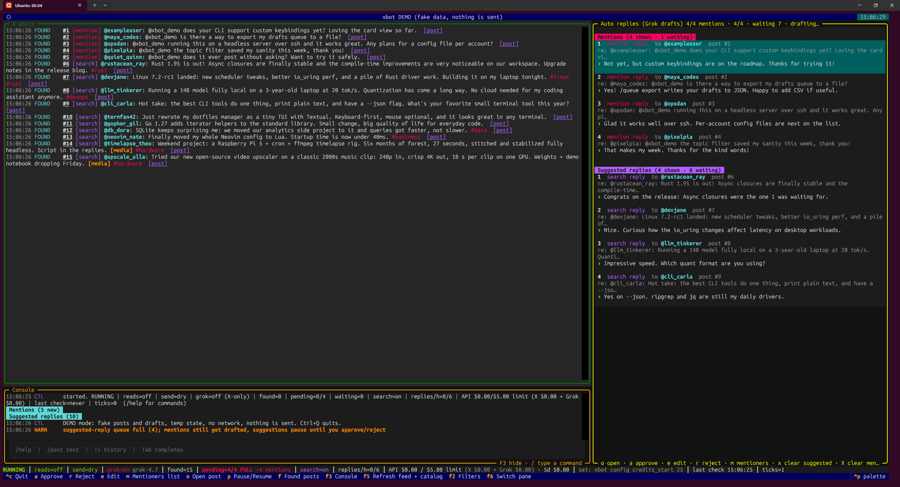
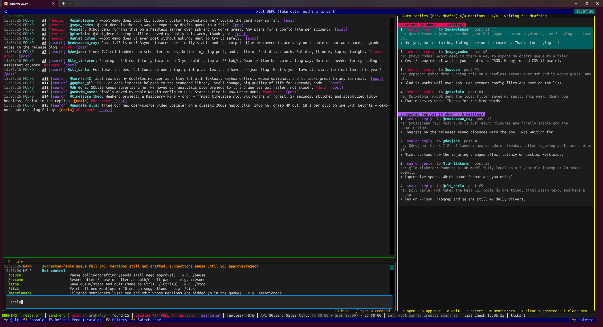
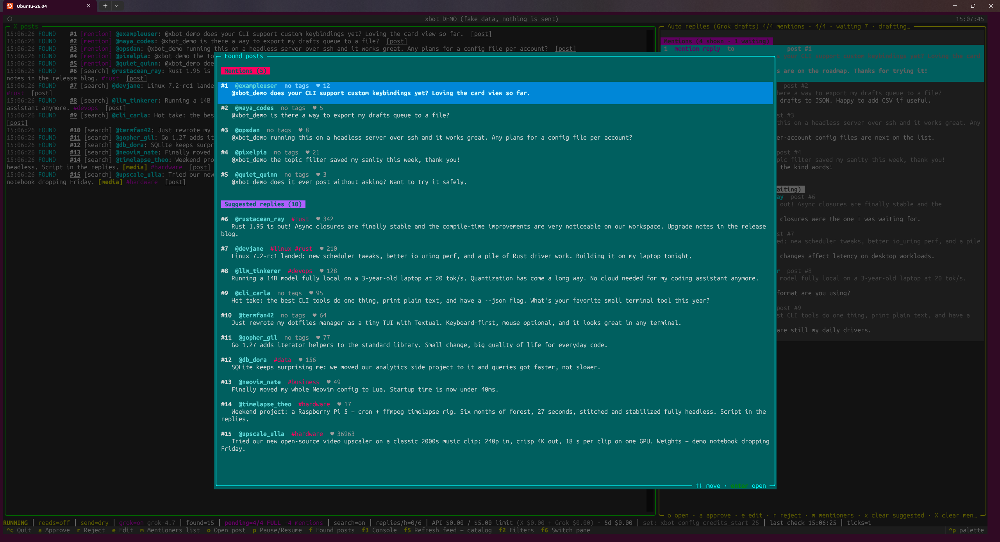
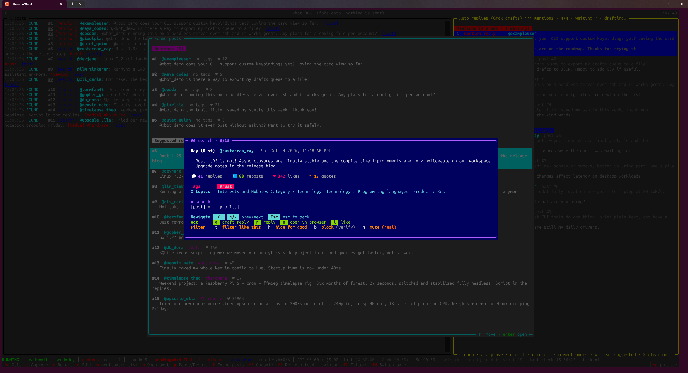
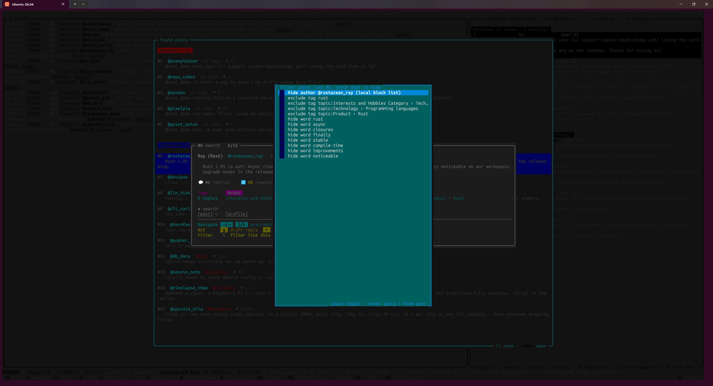
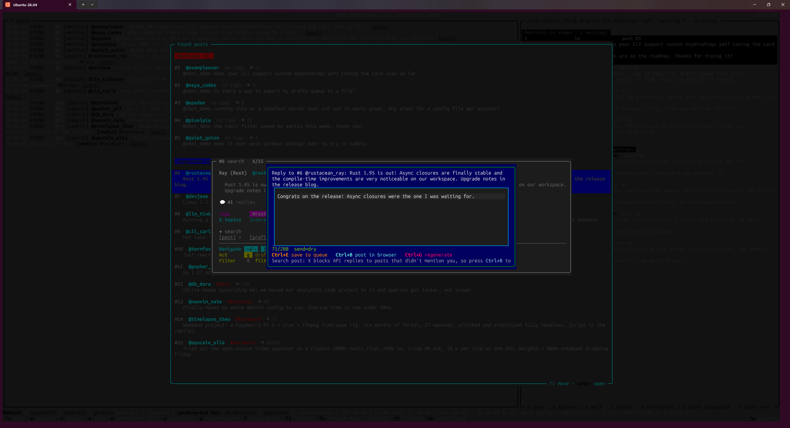

# x-poster-cli


> [!IMPORTANT]
> **Before you start**
> - **Required:** an X API developer account and keys: <https://console.x.com>
> - **Optional:** an xAI API key, only for Grok-drafted replies: <https://console.x.ai> (recommended: set the key to **5 requests/min or lower** and run `xbot config llm_rpm <same number>`; auto drafts fill in gradually, one slot per minute stays free for your manual `g`)

> [!TIP]
> **Easiest install: ask your [Grok Bot](https://x.ai/bot).** Paste this to it:
> `Clone and install https://github.com/gunnar-xibestar/x-poster-cli following GROK_BOT_SETUP.md`
> It follows [GROK_BOT_SETUP.md](GROK_BOT_SETUP.md). Want to change it? Ask your Grok Bot to fork it to a private repo and customize the code.

- A terminal X (Twitter) client/bot.
- Finds tech posts on X and shows your mentions and suggested posts as cards in a terminal UI.
- Helps you draft replies, optionally with Grok via the xAI API.
- **Every reply is approved by you by hand.**
- The Python package and launcher command are both wrapped up as `xbot`.

## Requirements
- An X API developer account (for viewing posts): an app at <https://console.x.com> with keys, for live reads and sends. Without keys only `xbot sample` (fake demo data) is useful.
- Linux (WSL works too) with these packages:
  - Python **3.10+** with `venv` (`sudo apt install python3-venv` on Debian/Ubuntu)
  - `mpv` **0.41+** for [media playback](docs/MEDIA_PLAYBACK.md) in the terminal (`sudo apt install mpv`)
- Optional: an xAI API key with credits, for Grok drafts. Leave it empty and xbot runs **X-only**.
- Optional: an xAI management key, for the real credit balance in the status bar (see [xAI management key](docs/GETTING_KEYS.md#xai-management-key-optional-real-credit-balance)).

## Screenshots
**Main screen** — top: X posts (mentions numbered and listed first, then suggested posts, `[media]` on posts with photos or videos); below it the **console**; the auto-reply queue on the right (up to 4 Grok-drafted **Mentions**, then up to 4 **Suggested replies**, each header showing `N shown · M waiting`), status bar below. Queue keys: `o` open (a click only highlights) · `a` approve · `e` edit · `r` reject · `m` mentioners list · `x`/`X` clear suggested/mention drafts.


**Console** — output, errors and the command line (`/help` shown here); `Tab` completes commands, `↑`/`↓` browse your history, `F3` hides/shows it, `/` brings it back to type.


**Post selection** (`f`) — every found post, mentions first, then suggested replies; arrows + `Enter` open a card.


**Post view** — the post card: author, date, text, metrics, tags, X topics, links, and one-key actions (`a`/`d` previous/next post).


**Edit tags** (`t` on a card) — filter posts like this one: its author, tags, topics and words; `space` toggles, `Enter` applies and hides the post, `Esc` cancels.


**Auto reply** (`g` on the card) — reply editor with a Grok-drafted reply; `Ctrl+E` save to queue, `Ctrl+B` post in browser, `Ctrl+G` regenerate.


## Quick install
Prefer a hand? See the [Grok Bot install tip](#x-poster-cli) at the top. Otherwise, here is the old-fashioned way:

```bash
git clone https://github.com/gunnar-xibestar/x-poster-cli.git
cd x-poster-cli
./install.sh
```
The installer:
- creates `.venv` and installs `requirements.txt`
- makes a launcher at `~/.local/bin/xbot`
- creates `~/.config/xbot/env` from `.env.example` with `chmod 600`

It never uses sudo and is safe to run again.

## Usage
```bash
xbot            # or: .venv/bin/python -m xbot
```
Helper commands:

| Command | What it does |
|---|---|
| `xbot` | Start the terminal UI |
| `xbot sample` | Demo mode: the real UI with fake posts and drafts (no network, nothing sent, config/state untouched) |
| `xbot search "query" [--play N]` | Print recent X search results; `--play N` opens the Nth result with media in the mpv viewer |
| `xbot config` | List all settings (`~/.config/xbot/config.json`) |
| `xbot config <key>` / `xbot config <key> <value>` | Show / set one setting, e.g. `xbot config video_scale 0.8` |
| `xbot config edit` | Edit config.json in `$EDITOR` (nano), validated on save |
| `xbot config reset` | Reset settings to defaults (old file backed up) |
| `xbot secrets` | Edit the keys file `~/.config/xbot/env` in nano (values never printed) |
| `xbot login` | OAuth 2.0 login for user-context calls (likes) |
| `xbot fix-perms` | Set `~/.config/xbot` and `~/.local/state/xbot` to 0700, their files to 0600 |
| `xbot --insecure-perms` | Start even if the env file permissions are too open (not recommended) |

## Media playback
See [Media playback](docs/MEDIA_PLAYBACK.md) for the in-terminal photo and video viewer.

## Docs
- [Features](docs/FEATURES.md): what xbot does
- [Keys](docs/KEYS.md): keyboard shortcuts
- [Commands](docs/COMMANDS.md): most-used slash commands
- [Getting keys](docs/GETTING_KEYS.md): X API and xAI key steps
- [Grok drafting](docs/GROK_DRAFTING.md): `/align` persona and learning from your last 8 edits
- [Configuration](docs/CONFIGURATION.md): env file, base URL, settings and paths
- [Safety](docs/SAFETY.md): approvals, costs, filters and secrets
- [Troubleshooting](docs/TROUBLESHOOTING.md): common errors and fixes
- [Reference](docs/REFERENCE.md): full reference for everything

## Development

```
python3 -m venv .venv
.venv/bin/pip install -r requirements-dev.txt   # app deps (requirements.txt) + pytest, pytest-asyncio, -xdist, -timeout
.venv/bin/python -m pytest -q -n auto --timeout=30   # parallel (~15s); plain `pytest -q` runs serially (~100s)
ruff check xbot tests                                # lint (rules in ruff.toml)
```

`pytest.ini` sets `asyncio_mode = auto` and `pythonpath = .`; run tests from the repo root. A copy of the
project needs `requirements.txt`, `requirements-dev.txt`, `pytest.ini` and `ruff.toml` next to `xbot/` and `tests/`.

## Uninstall
```bash
./install.sh --uninstall          # removes launcher and .venv, keeps keys/state
./install.sh --uninstall --purge  # also deletes ~/.config/xbot and ~/.local/state/xbot
```
Then delete the cloned folder.

## Credits
Built by a team of Grok Bot AI assistants (xAPI Dev and teammates), who wrote, tested and documented the code.

## License
GPL-3.0 © 2026 Gunnar Jackson. See [LICENSE](LICENSE).
