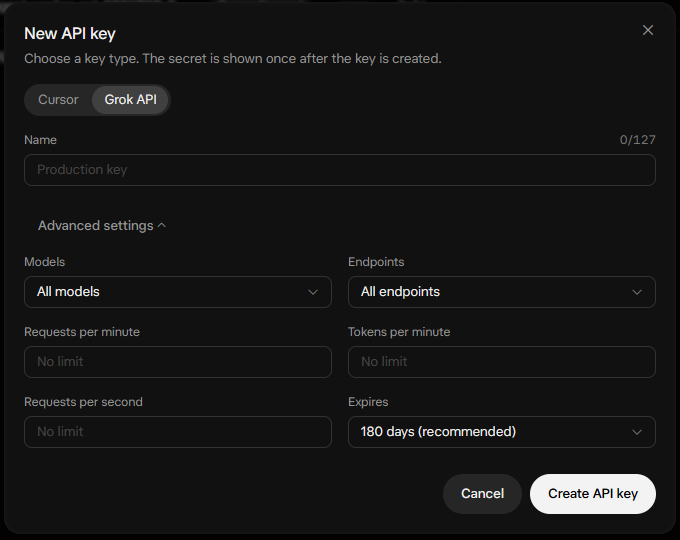

# Configuration

xbot reads keys from `~/.config/xbot/env` (or `$XBOT_CONFIG_DIR/env`). The installer creates it; to create or edit it by hand:
```bash
# make the config folder (no error if it already exists)
mkdir -p ~/.config/xbot
# copy the template into place, only if you don't have an env file yet (run inside the x-poster-cli folder)
[ -f ~/.config/xbot/env ] || cp .env.example ~/.config/xbot/env
# make the file readable by you only, since it holds your keys
chmod 600 ~/.config/xbot/env
# open it and paste your keys (format below); press Ctrl+X, then Y and Enter to save and exit
nano ~/.config/xbot/env
```
**Don't paste keys into chats, issues or shell history.**
```
XAI_API_KEY=
XBOT_BASE_URL=https://api.x.ai/v1
X_API_KEY=
X_API_SECRET=
X_ACCESS_TOKEN=
X_ACCESS_TOKEN_SECRET=
```
- **The xAI fields can stay empty.** xbot then runs X-only: search, mentions, the feed, post cards, opening posts
  in the browser and replies you write yourself all work; you just don't get Grok drafts. Add a key later and restart xbot.
- Real environment variables override this file. xbot warns you if the file can be read by other users.
- `XBOT_BASE_URL`: the default in code is `http://127.0.0.1:8767/v1` (a local usage proxy). Set it to
  `https://api.x.ai/v1` to use xAI directly (the template already does this).
- `XBOT_MODEL` sets the model (default `grok-4.7`). You can also use `/model`. Supported: `grok-4.7`, `grok-4.6`,
  `grok-4.5` (names from docs.x.ai/docs/models); other names are used but warned about.
- Queue size: `max_pending` (suggested) and `max_mention_drafts` (mentions) default to **4** each; change with
  `/maxpending n` and `/maxmentions n`. Configs that still had the old default 10 are moved to 4 once.
- Settings are saved to `~/.config/xbot/config.json`. Runtime state (queue, found posts, filtered posts, logs)
  is kept in `~/.local/state/xbot/`. Override the paths with `XBOT_CONFIG_DIR` / `XBOT_STATE_DIR`.

## Creating the xAI API key



1. Open **console.x.ai** (or grok.com → API), go to **API Keys** and click **Create API key**.
2. **Name** it (e.g. `xbot`) and keep the type **Grok API**.
3. Open **Advanced settings**. **Models:** allow at least the model you use (`grok-4.7`; also `grok-4.6` / `grok-4.5` if you switch with `/model`).
4. **Endpoints:** restricting the key to **chat** only is fine. xbot only calls `POST /v1/chat/completions`
   (`xbot/llm.py`); it never uses the Responses, image, voice or embeddings endpoints.
5. **Requests per minute (recommended: 5 or lower):** set the key's limit to **5** requests per minute (or lower)
   so a leaked key or a runaway loop can't be abused, and tell xbot the same number: `xbot config llm_rpm 5`
   (default 5; `0` = no pacing). Automatic drafting uses up to `llm_rpm - 1` per minute (default 4,
   `llm_auto_rpm`); one slot is always kept for your manual `g` drafts, which wait a moment for a free slot instead
   of failing. Drafts that don't fit in the current minute fill in gradually; Grok answering SKIP for a low-value
   post also uses a request. Lower keys work too (`xbot config llm_rpm 1`: ~1 draft per minute, `g` goes first).
   If the key is below `llm_rpm`, xbot handles the 429 by pausing for `Retry-After` and retrying automatically.
6. Click **Create**, copy the key once and put it in `~/.config/xbot/env` as `XAI_API_KEY=...` (never in chat, git or
   screenshots), then restart xbot.

## `xbot config` (settings from the shell)

- `xbot config` prints every setting and the file path (`~/.config/xbot/config.json`).
- `xbot config llm_rpm 1` sets one value (type- and range-checked: `llm_rpm` >= 1 or 0 = pacing off;
  `llm_auto_rpm` is clamped to `llm_rpm`). Restart xbot to apply.
- `draft_batch` (default 4; configs still on the old default 8 are moved to 4 once): max posts (mentions or search posts) per Grok request. Each request goes to whichever queue (mention drafts vs suggested replies) is emptiest relative to its cap, alternating when tied; requests that only prefill run once both queues are full, and the pool is shared about half-and-half between mentions and search posts. Each request drafts enough to fill the free queue slots and uses the rest to **prefill** drafts for the next feed posts (feed order); 1 = one post per request. Falls back to one post per request if the model ignores the JSON format. Each Grok request may take up to 180 s; a timeout logs `Grok timed out after 180s drafting N posts; will retry next refresh` and those posts are drafted again later.
- `style_examples` (default 8): when you edit a Grok draft and approve or save it, xbot keeps (post, Grok draft, your text) in `~/.local/state/xbot/style_examples.jsonl` (last 50, truncated) and puts the newest N in the drafting prompt as replies in your voice. Hidden, filtered or blocked posts are never used. Disable with `xbot config style_examples 0`; forget them with `/style clear`.
- `prefill_max` (default 20): size of the stored prefill pool (`state.json`, keyed by post id, survives restarts). When the queue is full and every waiting feed post has a stored draft, or the pool is at `prefill_max`, no Grok request is made (queue title `drafts full`). A freed slot (approve/reject/clear) is filled from the pool instantly with no API call; `g` on a post with a stored draft uses it; hiding or filtering a post drops its stored draft. `max_replies_per_hour` limits live reply **sends** only.
- `xbot config edit` opens the file in `$EDITOR` (default `nano`).
- Unknown keys print the list of valid keys. API keys never live here (they're in `~/.config/xbot/env`).

## Media viewer (`v` on a card)

`v` shows every photo, video and GIF of the post in the terminal with mpv (nothing saved to disk); `A`/`D` browse the items. `A`/`D` keep going past the post's last/first item into the next/previous post with media in the same list (feed order, or the search results for `--play`); posts without media are skipped. The controls line shows `post 3/12 · @handle · 2/4 · photo …`, `l` likes the post on screen (once per post), and `q`/`Esc` returns with the card moved to the post you viewed last. There is no external-player or browser path for media.

- `video_vo` (`auto` | `sixel` | `tct`): mpv output; `auto` = sixel on Windows Terminal (cell size estimated when WSL reports 0 pixels) or any sixel terminal reporting its pixel size, else tct. Videos use the highest-bitrate mp4 that fits the terminal height; photos are fetched at X's `name=large` size and shown with `--image-display-duration=inf`. Sixel uses an adaptive palette with Floyd-Steinberg dithering. The picture is sized to the terminal minus two rows at the bottom (plus one spare row), where xbot draws the controls line (never over the picture); it is redrawn after every item loads. Sixel cell size comes from the terminal, else the startup probe, else a small 8x16 px guess (WSL reports 0 pixels). mpv does not read the terminal: xbot reads keys in raw mode (no echo; mouse, focus and paste reports dropped; mouse tracking off while mpv runs) and forwards them to mpv over IPC as keypresses; `q`/`Esc` return to xbot and the terminal is restored (`stty sane`).
- mpv is started so it can never open a GUI window (that would steal keyboard focus from the terminal, e.g. under WSLg): one explicit `--vo` (sixel or tct, no fallback list), `--force-window=no --idle=no --audio-display=no --stop-screensaver=no --hwdec=no --terminal=yes --input-terminal=no`, and an environment without `DISPLAY`, `WAYLAND_DISPLAY`, `WAYLAND_SOCKET`, `XDG_SESSION_TYPE`, `XAUTHORITY`, `DBUS_SESSION_BUS_ADDRESS` (on WSL with `PULSE_SERVER` also without `XDG_RUNTIME_DIR`). Your own `mpv.conf` is still read; if it sets e.g. `vo=gpu` it is overridden.
- `video_audio` (`off` | `on`, default `off`): off runs mpv with `--mute=yes`.
- `video_scale` (0.2–1.0, default `0.6`): in the sixel viewer, videos and GIFs are drawn in a box this share of the picture area (aspect-fitted to the media's size), centred above the controls line. Smaller = fewer sixel bytes per frame = more fps. Videos also use a fixed palette, no dithering, a fast scaler and `--framedrop=vo`. Photos always use the full area (centred, 256-colour adaptive palette, fs dithering). `xbot config video_scale 0.6`.
- An expired video URL (403) refetches the post once. CLI: `xbot search "query" --play N` shows all media of the Nth result that has media.
- Removed: `video_player` (media is always the in-terminal mpv viewer) and `preview_renderer` (the `i` preview panel is gone). Old config files that still contain them load fine; the keys are ignored and dropped on the next save.


## API spend limit (X + Grok) and credits

- **`spend_limit`** (default **$5**, always on): per-session limit on **combined X API + xAI (Grok) spend** (both portions start at $0 every session; the daily X total for `/cap` is separate and not in the limit math). Set with
  `xbot config spend_limit 5` or in the app with `/limit 5` (accepts `5`, `$5`, `5.00`; positive amounts only,
  `off`/`0` are rejected). `/limit` alone shows the limit, Grok spend this session and what is left. Changes apply at once
  and are saved to `config.json` atomically. xbot checks before every Grok request; once spend reaches the limit it
  sends nothing more, saves queue/state and exits with `xbot stopped: API spend limit $X reached ...`. On **any**
  exit (quit, limit, Ctrl+C, crash) the session spend resets to $0 (per-day totals for est. credits are kept) and xbot
  prints `xbot session: 1h 23m · API spent $0.42 of $5.00 limit (X $0.10 + Grok $0.32)`.
- **Last 5 days** (not a setting): a rolling 5 x 24 h total of X + Grok API spend, shown next to the session spend in the status bar (`API $0.12 / $5.00 limit (X $a + Grok $b) · 5d $3.40`), in `/limit` and on the exit line (`… · last 5 days $3.40`). Every live charge is stored with its timestamp in `~/.local/state/xbot/state.json` (`spend_log`, entries older than 5 days pruned), so it persists across sessions and is not reset on exit. It does not count toward `spend_limit`.
- Spend is tracked per request from xAI's own `usage.cost_in_usd_ticks` (exact cost) when the response carries it,
  otherwise tokens x docs.x.ai/docs/models prices (grok-4.7/4.6: $2.00 in, $0.50 cached, $6.00 out per 1M tokens;
  grok-4.5: $2.00/$0.30/$6.00). The status bar shows `API $0.42 / $5.00 limit (X $0.10 + Grok $0.32) │ credits…` (the old `X~$` entry is gone; with `/cap` set, `X today $…/cap` is still shown for the separate daily X cap).
- **Real credit balance (ground truth):** add `XAI_MANAGEMENT_KEY=...` to `~/.config/xbot/env` (a *management* key
  from console.x.ai settings, not your API key; your console user needs Management Keys permission). xbot finds your
  team via `GET https://api.x.ai/v1/api-key` (uses `XAI_API_KEY`; or set `XAI_TEAM_ID`) and reads
  `GET https://management-api.x.ai/v1/billing/teams/{team_id}/prepaid/balance` at startup and every 5 minutes, shown as
  `credits: $X.XX (xAI, as of HH:MM)`. The key is a secret: redacted, never logged or printed.
- **Estimate instead:** `xbot config credits_start 25` and `xbot config credits_start_date 2026-10-26` (UTC date;
  empty = all tracked spend). Shows `est. credits left: $start - Grok spend since that date`. With neither set the bar
  shows the hint `set: xbot config credits_start 25`.
