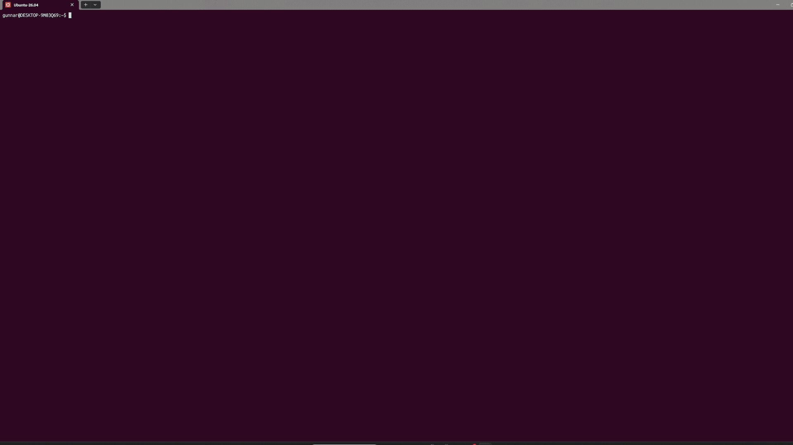

# Media playback
<!-- GIF placeholder: docs/media-playback.gif (to be supplied) -->

Press `v` on a post card, or click **[media]** in the feed, to view every photo, video and GIF of the post right in the terminal with `mpv` (sixel graphics; never a browser or a separate window). Pictures are centred above a controls line; videos and GIFs use `video_scale` of the picture area (default 0.6; smaller = smoother playback), photos all of it.

| Key | Action |
|---|---|
| `a` / `d` | Seek 5 s back / forward (videos) |
| `←` / `→` | Previous / next media item, across posts |
| `↑` / `↓` | Volume up / down |
| `space` | Pause / play |
| `m` | Mute / unmute |
| `l` | Like the post |
| `r` | Remove: mute the author and hide the post |
| `t` | Tags popup (filter posts like this one) |
| `z` | Photos: toggle large fit (whole terminal) |
| `q` / `Esc` / `Ctrl+C` | Close the viewer, back to xbot |

Settings:
- `xbot config video_scale 0.6`: share of the picture area for videos/GIFs (0.2–1.0).
- `xbot config sixel_scale auto`: `auto` measures the terminal; set a factor (0.5–3.0, e.g. `1.25`) if the picture area is too small or too big for your screen (e.g. display scaling on Windows Terminal).
- `xbot config video_audio on`: play sound (default `off`, muted).

Needs `mpv` **0.41+** and a sixel-capable terminal (Windows Terminal, WezTerm, foot, …). `yt-dlp` is optional and not used by xbot (it plays the direct mp4 URLs from the X API).
